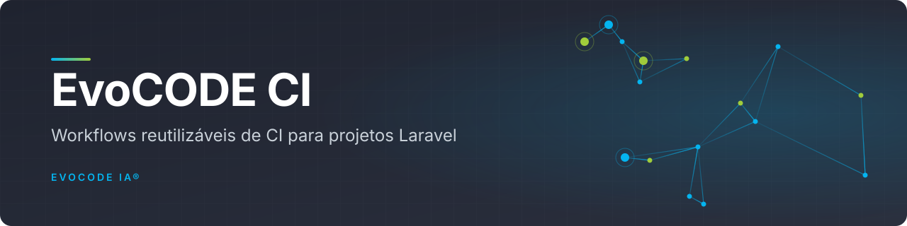
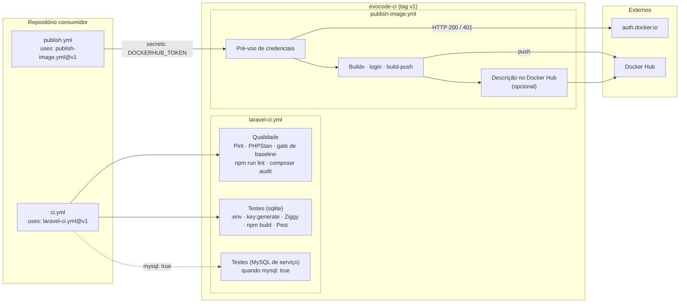

<div align="center">



<br>

**Workflows reutilizáveis de GitHub Actions para os projetos Laravel e as imagens Docker da EvoCODE IA® e da NextHop Solutions®.**

[](LICENSE)
[](https://github.com/evocode-ia/evocode-ci)
[](https://github.com/evocode-ia/evocode-ci/tags)
[](https://github.com/evocode-ia/evocode-ci/commits/main)


[Arquitetura](#arquitetura) · [Começando](#começando) · [Uso](#uso) · [Workflows](.github/workflows)

</div>

---

## Sumário

- [Sobre](#sobre)
- [Destaques](#destaques)
- [Arquitetura](#arquitetura)
- [Stack](#stack)
- [Começando](#começando)
- [Uso](#uso)
- [Estrutura do projeto](#estrutura-do-projeto)
- [Testes e qualidade](#testes-e-qualidade)
- [Versionamento](#versionamento)
- [Contribuição](#contribuição)
- [Segurança](#segurança)
- [Licença](#licença)
- [Autor](#autor)

## Sobre

Este repositório hospeda os workflows reutilizáveis (`workflow_call`) que os projetos Laravel e as
imagens Docker da **EvoCODE IA®** e da **NextHop Solutions®** consomem via `uses:`.

É público por um motivo prático, não por escolha de exposição: um workflow reutilizável hospedado em
repositório privado só pode ser chamado por repositórios da **mesma organização**, e os projetos que
consomem esta pipeline estão espalhados por três organizações. Aqui não há segredo, credencial nem
endereço interno, só passos de build.

| Workflow | O que faz |
|---|---|
| [`laravel-ci.yml`](.github/workflows/laravel-ci.yml) | CI para projetos Laravel: Pint, PHPStan (com gate de baseline), `composer audit`, build de frontend (Vite/Ziggy) e testes com Pest, em sqlite ou MySQL de serviço. |
| [`publish-image.yml`](.github/workflows/publish-image.yml) | Publica imagem no Docker Hub com pré-voo de credenciais (valida formato, não só presença) e, opcionalmente, atualiza a descrição do repositório no Docker Hub a partir do README. |

## Destaques

- **Uma pipeline, vários repositórios**: o projeto consumidor declara só a versão do PHP e o que
  quer ligar ou desligar.
- **Gate de baseline do PHPStan**: o PR falha se o `phpstan-baseline.neon` crescer em relação à
  branch alvo.
- **Cobertura com piso por catraca**: `pcov` sob demanda, número publicado no resumo do job e piso
  configurável que só sobe.
- **sqlite ou MySQL**: a entrada `mysql` troca o job de testes por um com MySQL de serviço.
- **Publish com pré-voo**: valida usuário e token do Docker Hub contra `auth.docker.io` antes do
  login e devolve um código HTTP legível.
- **Actions fixadas por SHA** no `publish-image.yml`, o job que autentica no registry e faz push.

## Arquitetura



O `laravel-ci.yml` tem dois jobs de teste porque o GitHub não aceita `if:` em `services:`. Só um deles
roda, escolhido pela entrada `mysql`. A duplicação fica aqui, num lugar só, em vez de espalhada pelos
repositórios.

### Decisões de design

Cada decisão embutida nos workflows veio de uma pipeline vermelha ou de um incidente real, não de
preferência. Os comentários nos próprios arquivos `.yml` documentam o porquê passo a passo.

**`laravel-ci.yml`**

- **`coverage: none` por padrão.** xdebug sem ninguém consumindo cobertura multiplica o tempo da
  suíte, e o overhead de memória derruba as maiores. Pior: a proteção de loop infinito do xdebug
  mascara recursão real, que só aparece quando ele sai.
- **Versão do PHP vinda do `composer.lock`.** O `composer.json` pode declarar um mínimo que o lock não
  satisfaz; nesse caso o `composer install` nem completa.
- **`.env` → `key:generate` → sqlite → Ziggy → build → testes.** O Ziggy é gerado pelo artisan e não é
  versionado, e o build do frontend depende dele.
- **Build do frontend antes dos testes.** Suíte que renderiza Inertia precisa do manifest do Vite; sem
  ele, toda requisição HTTP responde 500.
- **`pcov` em vez de `xdebug` quando `coverage: true`.** Ordens de grandeza mais barato, sem o custo
  que faz o xdebug ficar proibido no resto do tempo.
- **Gate do baseline do PHPStan.** "O baseline só encolhe" só é regra se alguém verificar; sem o gate,
  basta regenerar o arquivo para esconder um erro novo.

**`publish-image.yml`**

- **Usuário do Docker Hub como `input`, não `secret`.** É o namespace público, já em claro na tag da
  imagem. Guardá-lo como secret não protegia nada e custava a visibilidade que teria encurtado o
  diagnóstico de um incidente real (kairo, 25/08/2026: quatro dias sem publicar imagem porque o campo
  de usuário guardava um token, e a checagem local só testava se o secret estava vazio).
- **Pré-voo contra `auth.docker.io`.** O `docker/login-action` traduz qualquer problema para
  "malformed HTTP Authorization header", mensagem que não menciona credencial. O pré-voo devolve um
  código HTTP legível antes do login acontecer.
- **Actions fixadas por SHA de 40 caracteres, não por major.** Este é o job que autentica no Docker
  Hub e roda com `push: true`; tag de major é ponteiro móvel.
- **Plataforma declarada, não herdada do runner.** `linux/amd64` por padrão: os nós de produção são
  amd64, e uma imagem construída em arm64 não roda lá.
- **Cache `type=gha` em escopo próprio.** O job tem credencial de registry; o escopo isolado garante
  que ele só lê o que ele mesmo escreveu.

## Stack

| Camada | Tecnologia | Versão |
|---|---|---|
| Orquestração | GitHub Actions, workflows reutilizáveis (`workflow_call`) | — |
| PHP | `shivammathur/setup-php` com Composer v2 | `@v2`; versão do PHP vem da entrada `php-version` |
| Node.js | `actions/setup-node` | `@v4`; Node `24` por padrão |
| Banco de testes | sqlite ou serviço `mysql` | MySQL `8.4` por padrão |
| Checkout | `actions/checkout` | `@v5` (laravel-ci) · `v4.4.0` por SHA (publish-image) |
| Build de imagem | `docker/setup-buildx-action` · `docker/login-action` · `docker/build-push-action` | `v4.3.0` · `v4.6.0` · `v7.3.0` (por SHA) |
| Descrição no Docker Hub | `peter-evans/dockerhub-description` | `v5.0.0` (por SHA) |
| Ferramentas do projeto consumidor | Pint, PHPStan, Pest (`php artisan test`), Ziggy, Vite | as do próprio projeto |

## Começando

### Pré-requisitos

Para `laravel-ci.yml`, o repositório consumidor precisa ter:

- `composer.json`/`composer.lock` com Pint (`vendor/bin/pint`) e, se `phpstan: true`, PHPStan
  (`vendor/bin/phpstan`).
- `.env.example`, copiado para `.env` antes do `php artisan key:generate`.
- `package-lock.json`, quando `frontend` ou `frontend-lint` estiverem ligados (o cache e o `npm ci`
  usam npm), e o script `npm run build` (e `npm run lint`, se `frontend-lint: true`).
- Com `mysql: true`, um `phpunit.xml` cujo `DB_DATABASE` bata com a entrada `mysql-database`.

Para `publish-image.yml`:

- Variável do repositório `DOCKERHUB_USERNAME` (variável, **não** secret).
- Secret `DOCKERHUB_TOKEN`, com escopo Read & Write no Docker Hub.

### Instalação

Não há o que instalar. Crie o workflow no repositório consumidor e aponte o `uses:` para a tag `v1`,
como nos exemplos abaixo.

## Uso

### `laravel-ci.yml`

Chamada típica no repositório consumidor:

```yaml
name: CI

on:
  push:
    branches: [main]
    paths-ignore: ["**/*.md", "docs/**"]
  pull_request:
    branches: [main]
    paths-ignore: ["**/*.md", "docs/**"]
  workflow_dispatch:

permissions:
  contents: read

concurrency:
  group: ${{ github.workflow }}-${{ github.ref }}
  cancel-in-progress: true

jobs:
  ci:
    uses: evocode-ia/evocode-ci/.github/workflows/laravel-ci.yml@v1
    with:
      php-version: "8.4"
```

Com todas as entradas declaradas, nos valores padrão (só `php-version` é obrigatória):

```yaml
jobs:
  ci:
    uses: evocode-ia/evocode-ci/.github/workflows/laravel-ci.yml@v1
    with:
      php-version: "8.4"        # obrigatória
      node-version: "24"
      working-directory: "."
      php-extensions: ""
      phpstan: true
      baseline-gate: true
      frontend: true
      frontend-lint: false
      composer-audit: true
      coverage: false
      coverage-min: 0
      sqlite-file: true
      mysql: false
      mysql-version: "8.4"
      mysql-database: "testing"
```

| Entrada | Tipo | Padrão | O que faz |
|---|---|---|---|
| `php-version` | string | — (obrigatória) | Versão do PHP. Use a que o `composer.lock` exige, não a declarada no `composer.json`. |
| `node-version` | string | `24` | Versão do Node. |
| `working-directory` | string | `.` | Diretório do Laravel, quando ele não fica na raiz do repositório. |
| `php-extensions` | string | vazio | Extensões extras do PHP, separadas por vírgula. |
| `phpstan` | boolean | `true` | Roda o PHPStan no job de qualidade. |
| `baseline-gate` | boolean | `true` | Falha o PR se o `phpstan-baseline.neon` crescer em relação à branch alvo. |
| `frontend` | boolean | `true` | Instala e builda o frontend antes dos testes. |
| `frontend-lint` | boolean | `false` | Roda `npm run lint` no job de qualidade. |
| `composer-audit` | boolean | `true` | Roda `composer audit` no job de qualidade. |
| `coverage` | boolean | `false` | Mede cobertura com pcov e publica o número no resumo do job. |
| `coverage-min` | number | `0` | Piso de cobertura. O PR falha se cair abaixo dele. Sobe por catraca: nunca desce. |
| `sqlite-file` | boolean | `true` | Cria `database/database.sqlite` antes dos testes. |
| `mysql` | boolean | `false` | Sobe um MySQL de serviço para a suíte, em vez de sqlite. |
| `mysql-version` | string | `8.4` | Tag da imagem do MySQL de serviço. |
| `mysql-database` | string | `testing` | Nome do banco criado no serviço. Tem que bater com o `DB_DATABASE` do `phpunit.xml`. |

### `publish-image.yml`

```yaml
jobs:
  publish:
    uses: evocode-ia/evocode-ci/.github/workflows/publish-image.yml@v1
    with:
      tags: |
        meuusuario/minhaimagem:latest
        meuusuario/minhaimagem:${{ github.sha }}
      username: ${{ vars.DOCKERHUB_USERNAME }}
    secrets:
      DOCKERHUB_TOKEN: ${{ secrets.DOCKERHUB_TOKEN }}
```

Com todas as entradas declaradas, nos valores padrão (`tags` e `username` são obrigatórias):

```yaml
jobs:
  publish:
    uses: evocode-ia/evocode-ci/.github/workflows/publish-image.yml@v1
    with:
      tags: |                       # obrigatória
        meuusuario/minhaimagem:latest
      username: ${{ vars.DOCKERHUB_USERNAME }}  # obrigatória
      context: .
      file: ./Dockerfile
      platforms: linux/amd64
      labels: ""
      target: ""
      build-args: ""
      description-repository: ""
      short-description: ""
      readme-filepath: ./README.md
      cache-scope: publish-image
    secrets:
      DOCKERHUB_TOKEN: ${{ secrets.DOCKERHUB_TOKEN }}
```

| Entrada | Padrão | O que faz |
|---|---|---|
| `tags` | — (obrigatória) | Tags completas (`repo:tag`), uma por linha. |
| `username` | — (obrigatória) | Usuário do Docker Hub. Passe `vars.DOCKERHUB_USERNAME`. |
| `context` | `.` | Contexto do build. |
| `file` | `./Dockerfile` | Caminho do Dockerfile. |
| `platforms` | `linux/amd64` | Plataformas do build. Declarado, não herdado do runner. |
| `labels` | vazio | Labels OCI. |
| `target` | vazio | Estágio do Dockerfile a construir, em build multi-stage. |
| `build-args` | vazio | Argumentos de build (`NOME=valor`, um por linha), para dado do próprio build que a imagem carrega e o contexto não tem, como commit e data. Nunca segredo: fica gravado no histórico da imagem. |
| `description-repository` | vazio | `namespace/repo` cuja descrição no Docker Hub deve ser atualizada a partir do README. Vazio desliga o passo. |
| `short-description` | vazio | Descrição curta do repositório no Docker Hub. |
| `readme-filepath` | `./README.md` | Caminho do README publicado como descrição longa. |
| `cache-scope` | `publish-image` | Escopo do cache `type=gha`, isolado do namespace padrão. |

Secret obrigatório: `DOCKERHUB_TOKEN`.

> [!IMPORTANT]
> `username` vem de `vars.DOCKERHUB_USERNAME`, variável do repositório, **não** secret. É o namespace
> público, já escrito em claro na tag da imagem. Guardá-lo como secret só mascarava o log e escondia
> erro de digitação. Só `DOCKERHUB_TOKEN` é segredo, e o Docker Hub autentica pelo nome de usuário,
> não pelo e-mail da conta.

Ao final, o job publica as tags enviadas no resumo da execução.

## Estrutura do projeto

```text
evocode-ci/
├── .github/
│   ├── assets/            # banner do README
│   └── workflows/
│       ├── laravel-ci.yml     # CI reutilizável para projetos Laravel
│       └── publish-image.yml  # publicação reutilizável de imagem no Docker Hub
├── LICENSE
└── README.md
```

## Testes e qualidade

Este repositório não tem suíte de testes própria: o conteúdo dos arquivos `.yml` **é** o artefato.
Cada mudança é validada pelo consumo real. Abra um PR num projeto consumidor apontando para a branch
antes de mover a tag `v1`:

```yaml
uses: evocode-ia/evocode-ci/.github/workflows/laravel-ci.yml@<branch>
```

## Versionamento

A tag `v1` aponta para a versão estável. Consuma sempre por tag, nunca por `@main`.

## Contribuição

1. Crie uma branch a partir da `main`.
2. Leia os comentários do workflow antes de mudar um passo: eles registram o incidente que motivou
   cada decisão.
3. Escreva commits no padrão Conventional Commits, por exemplo
   `feat(publish): build-args como input opcional`.
4. Valide a mudança num repositório consumidor apontando o `uses:` para a branch.
5. Abra o PR. Mova a tag `v1` só depois de validar no consumidor.

## Segurança

Não abra issue pública para reportar vulnerabilidade. Use o reporte privado do GitHub Security
Advisories deste repositório ou fale com o autor pelo
[GitHub](https://github.com/elizandropacheco).

Este repositório é público: nunca adicione segredo, credencial ou endereço interno aos workflows.

## Licença

Distribuído sob a licença MIT. © 2026 EvoCODE IA®. Veja [LICENSE](LICENSE).

## Autor

<table>
  <tr>
    <td align="center">
      <a href="https://github.com/elizandropacheco">
        <br>
        <sub><b>Elizandro Pacheco</b></sub>
      </a><br>
      <sub>Desenvolvedor e autor do projeto</sub>
    </td>
  </tr>
</table>

[](https://elizandropacheco.io)
[](https://www.linkedin.com/in/elizandropacheco)
[](https://github.com/elizandropacheco)
[](https://www.youtube.com/@ElizandroPacheco)
[](https://www.instagram.com/elizandropacheco)

<div align="center">
<sub>Feito por <a href="https://github.com/elizandropacheco">Elizandro Pacheco</a> · Um produto <a href="https://evocode.ia.br">EvoCODE IA®</a>, da casa <a href="https://nexthop.solutions">NextHop Solutions®</a></sub>
</div>
