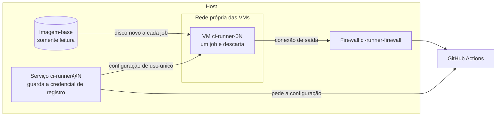

# Runners próprios

Os builds rodam em máquinas nossas, pelo próprio GitHub Actions: os workflows, a aba Actions e os checks do PR
continuam iguais. Só muda o `runs-on`. **Cada job roda em uma VM nova, descartada ao final.** O motivo está na
[ADR 0001](adr/0001-runners-proprios.md).

Este repositório é público: aqui entram a estrutura e os scripts, sem segredo nem endereço real de máquina.

## Como usar

### Em um workflow

```yaml
jobs:
  testes:
    runs-on: [self-hosted, evocode-linux]
```

### Em um workflow reutilizável desta casa

A entrada é JSON, então as aspas fazem parte do valor:

```yaml
jobs:
  ci:
    uses: evocode-ia/evocode-ci/.github/workflows/laravel-ci.yml@v1
    with:
      runs-on: '["self-hosted","evocode-linux"]'
      php-version: "8.4"
```

Sem essa entrada, o job pede `ubuntu-latest`. Se os runners hospedados estiverem desligados na organização, ele fica
em `queued`, sem falhar.

### O que muda em relação ao `ubuntu-latest`

- **Sistema:** Ubuntu 24.04 com Docker, buildx, Compose, `git`, `jq`, `build-essential` e PHP 8.3, 8.4 e 8.5 já
  instalados. O resto vem pelas actions de sempre (`setup-node`, `setup-python`), que funcionam igual.
- **Imagens de serviço:** `mysql:8.4`, `percona/percona-server:8.4` e `pgvector/pgvector:pg16` já estão na VM. Outras são
  baixadas a cada job, porque nada persiste. Se aparecer limite de downloads do Docker Hub, adicione a imagem em
  `infra/runner-vm/user-data.yaml` e refaça a imagem-base.
- **O cache do GitHub é lento aqui.** O download medido foi de 0,8 MB/s, e às vezes trava; a espera tem limite de 3
  minutos, e depois o job segue sem cache.
- **Falta algo?** Instale no próprio job ou peça para adicionar à imagem-base.

### Onde acompanhar

| O quê | Onde |
|---|---|
| Builds e logs | Aba **Actions** do repositório e checks do PR |
| Estado dos runners | Settings → Actions → Runners, da organização. O nome muda a cada job: `ci-runner-01-<horário>` |

## Devs externos

Ninguém precisa de acesso às máquinas, à VPN nem aos segredos: basta a conta no GitHub, com acesso ao repositório.
O dev abre o PR e vê o resultado nos checks, como em qualquer projeto.

**Ao dar acesso, leve em conta:** quem tem permissão de escrita em um repositório executa código como root na VM do
job e consegue ler os segredos do Actions **daquele repositório**, porque basta alterar um workflow em uma branch.
Isso vale para qualquer CI assim. A VM descartável e a amarração de IP por porta existem para esse código não sobreviver
ao job nem alcançar jobs de outros repositórios.

A permissão base da organização também conta: se ela for "escrita", todo membro tem esse poder em todo repositório, e uma
senha roubada basta sem 2FA obrigatório.

Não abra PR de fork nos runners sem revisar o workflow antes: quem só tem leitura também conseguiria executar código.

**Ao retirar o acesso de alguém que tinha escrita:** avalie a rotação dos segredos dos repositórios a que a pessoa tinha
acesso.

## Como está montado



| Peça | Onde | O que faz |
|---|---|---|
| `infra/runner-vm/instalar.sh` | Roda no host | Instala QEMU e libvirt, cria a rede isolada, monta a imagem-base e liga os serviços |
| `infra/runner-vm/ciclo-runner.sh` | Serviço `ci-runner@N` | Cria a VM, registra para um job, espera, descarta e recomeça |
| `infra/runner-vm/firewall.sh` | Serviço `ci-runner-firewall` | Regras que isolam a rede das VMs |
| `infra/runner-vm/user-data.yaml` | Montagem da imagem-base | Pacotes, PHP, imagens de serviço e o runner |

### O ciclo de um runner

1. O disco da VM é recriado, por cima da imagem-base, que nunca é alterada.
2. A VM sobe e o serviço pede ao GitHub uma configuração de uso único (`generate-jitconfig`).
3. O runner recebe um job, roda e termina.
4. A VM é destruída e o ciclo recomeça. A VM leva cerca de 30 segundos para ficar pronta.

O host não confia na VM para saber que acabou: confere no GitHub se o runner ainda existe e destrói a VM quando ele some,
ou ao passar de 8 horas de vida.

A credencial que pede a configuração fica no host, fora do alcance do job. Os runners não recebem conexão de fora:
buscam trabalho no GitHub. Nenhuma porta é aberta no host.

O firewall sobe antes do `libvirtd` e fecha tudo até descobrir a rota padrão. São duas tabelas `nft` próprias:

- **`ci_vm`:** bloqueios de IP, com prioridade anterior à do iptables. Continuam valendo quando o Docker ou o Tailscale
  reordenam as próprias regras ao reiniciar.
- **`ci_vm_l2`:** amarra cada porta da rede (`civmNN`) ao MAC e ao IP da própria VM. Sem ela, um job com root assume o IP
  de outra VM e recebe do host a configuração de registro que era dela.

Se o serviço `nftables` do host for habilitado com o `flush ruleset` padrão, as duas tabelas são apagadas, e parte do
isolamento cai. O ciclo confere isso: sem as tabelas, destrói a VM em execução e não sobe outra.

## Segurança

**Premissa:** quem tem escrita em um repositório executa código como root na VM do job. A VM é tratada como máquina
comprometida, e o estrago precisa ficar nela e acabar com ela.

| Proteção | Como |
|---|---|
| Nada passa de um job para o outro | Disco novo a cada job, a partir de imagem somente leitura |
| Sem credencial de registro na VM | Só uma configuração de uso único, entregue pela entrada padrão |
| Sem acesso ao host | VM separada, sem arquivo do host; tabela `nft` `ci_vm` |
| Sem acesso à rede local e à tailnet | A mesma tabela bloqueia redes privadas, `100.64.0.0/10`, metadata, IPv6 e a sub-rede pública do host |
| Sem acesso entre as VMs | Portas isoladas na bridge (`port isolated`) e IP e MAC amarrados por porta (`ci_vm_l2`) |
| Sem assumir outra VM | `ci_vm_l2` descarta MAC, ARP e IP de origem que não sejam os da própria porta |
| Teto de conexões por VM | Protege a tabela de conexões, que é compartilhada com o host |
| Sem virtualização aninhada | `disable=svm`: menos superfície do KVM do host |
| Sem repositório público nos runners | Grupo com `allows_public_repositories: false`; o ciclo recusa registrar se isso mudar |
| Chaves só para isto | A de administração não é pessoal, e a de host é conferida a cada conexão |

**O que continua aberto:**

- **Segredos do repositório do próprio job.** Quem tem escrita consegue lê-los, como em qualquer CI.
- **A chave de host é a mesma em todas as VMs.** Um job com root pode copiá-la. A garantia de que o host fala com a VM
  certa vem da amarração de IP por porta, não dessa chave.
- **Credencial no host.** Sem `/etc/evocode-ci/gh-token`, o serviço usa o `gh` de `CI_GH_USER`, que precisa de `admin:org`:
  qualquer processo desse usuário vira administrador da organização. Prefira um PAT fine-grained só com permissão de
  **Self-hosted runners**, em arquivo modo 600 de root, e retire `admin:org` do login pessoal.
- **Saída pela internet com o IP do servidor.** Ao contrário do `ubuntu-latest`, o job sai com o IP deste host. Se algum
  serviço libera esse IP em allowlist (SSH, banco, painel), o job herda a confiança: revise essas listas. E-mail (25, 465 e
  587) fica bloqueado.
- **Sem teto de banda e de I/O.** Um job pode ocupar a rede e o disco do host enquanto roda.
- **Disco.** Cada VM usa até 120 GB. O `instalar.sh` confere o espaço livre, mas ele continua dividido com o host.

**Em caso de incidente:** pare o serviço `ci-runner@N`, confira em Settings → Actions → Runners se sobrou algum runner,
remova-o e faça a rotação dos segredos do repositório envolvido.

**Depois de mudar o firewall, repita o teste de isolamento** (abaixo).

## Operação

Comandos rodados no host, por quem administra.

### Instalar

Use o hash de `noble-server-cloudimg-amd64.img` publicado em
`https://cloud-images.ubuntu.com/noble/current/SHA256SUMS`. `CI_GH_USER` é o usuário do host cujo `gh` tem `admin:org`:

```bash
sudo CI_ORG=evocode-ia CI_GH_USER=USUARIO CI_RUNNERS=3 CI_VM_IMG_SHA256=HASH infra/runner-vm/instalar.sh
```

Para dar `admin:org` ao `gh` em servidor sem navegador, rode o comando abaixo como `CI_GH_USER`, aperte Enter e
autorize o código em `https://github.com/login/device`:

```bash
GH_BROWSER=true gh auth refresh -h github.com -s admin:org
```

**Dimensione pela memória:** cada runner usa até 6 vCPU e 10 GB de RAM. Um runner atende um job por vez.

### Mudar a capacidade

```bash
sudo systemctl enable --now ci-runner@4
```

```bash
sudo systemctl disable --now ci-runner@4
```

Vão de 1 a 10; confira a memória antes de subir mais um, porque só o `instalar.sh` faz essa checagem. **Parar o serviço
derruba o job em andamento.** Cada organização precisa dos próprios runners; para outra, é preciso outra instalação.

**Não confirmado:** o GitHub só documenta runner próprio em workflow reutilizável quando ele é da mesma organização de
quem chama. Em outra organização, teste com um consumidor real antes de passar `runs-on` a este repositório.

### Atualizar a imagem-base

Refaz a imagem com pacotes novos. Rode de novo o `instalar.sh`: ele reinicia os serviços, então espere a fila esvaziar.

### Migrar de servidor

Os runners não guardam nada que precise ser levado, então não há backup a restaurar:

1. No servidor novo, rode o `instalar.sh`. A partir daí, os dois servidores atendem jobs.
2. No antigo, pare os serviços e apague as VMs:

   ```bash
   sudo systemctl disable --now ci-runner@1 ci-runner@2 ci-runner@3
   ```

   ```bash
   sudo virsh undefine ci-runner-01 --remove-all-storage
   ```

3. Para remover o isolamento do servidor antigo, se ele continuar em uso:

   ```bash
   sudo systemctl disable --now ci-runner-firewall
   ```

### Testar o isolamento

De dentro de uma VM, cada comando abaixo precisa falhar. Use um endereço real de cada tipo: o host pela bridge e pelo
IP público, uma porta publicada pelo Docker do host, uma máquina da tailnet, um vizinho da sub-rede pública e outra VM.

```bash
timeout 4 bash -c 'exec 3<>/dev/tcp/ENDERECO/PORTA' && echo VAZOU || echo bloqueado
```

Para entrar em uma VM:

```bash
sudo ssh -i /etc/evocode-ci/vm_ed25519 -o UserKnownHostsFile=/etc/evocode-ci/vm_known_hosts ci@10.77.0.10
```

Repita depois de reiniciar o host, o Docker ou o Tailscale.

### Rotina

| Tarefa | Como |
|---|---|
| Ver as VMs | `sudo virsh list --all` |
| Ver um runner | `systemctl status ci-runner@1` e `journalctl -u ci-runner@1` |
| Atualizar o runner | Automático, mas volta à versão da imagem-base a cada job: refaça a imagem de tempos em tempos |
| Limpar disco | Automático: o disco da VM é refeito a cada job |

### Problemas comuns

| Sintoma | Verifique |
|---|---|
| Job parado em "Waiting for a runner" | Runner ocupado ou serviço parado. Veja `systemctl status 'ci-runner@*'`; aumente a capacidade se for fila |
| `ci-runner@N` em erro de configuração | O `gh` de `CI_GH_USER` sem `admin:org`: o log mostra que o GitHub não entregou a configuração |
| Job com `ubuntu-latest` sempre em `queued` | Runners hospedados desligados na organização: troque o `runs-on` |
| Job em `queued` em repositório público | Os runners próprios não atendem repositório público |
| Job falha sozinho depois de 10 minutos | A VM caiu com ele em andamento. O job não é repetido: dispare de novo. O serviço recria a VM sozinho |
| Teste de frontend falha por tempo, às vezes | O host está sob carga, porque os runners dividem a CPU com o desenvolvimento e outras VMs. Medido com load acima de 15: 3 de 1553 testes estouraram 5 s. Repita o job; se for frequente, reduza runners ou aumente o limite de tempo no projeto |
| `startup_failure`, sem job criado | Cobrança da organização. O erro só aparece na página do run, na web: confira **Payment information** |
| VM sem internet | `sudo systemctl restart ci-runner-firewall`; depois, `sudo virsh net-list` |

## Custo

Runner próprio não consome minutos do GitHub hoje. O GitHub chegou a anunciar uma taxa por minuto e a adiou; confira
a página de preços antes de planejar em cima disso. O orçamento de Actions da organização bloqueia o uso ao atingir
o teto, e **ao bater o teto o Actions pode parar para toda a organização**.
