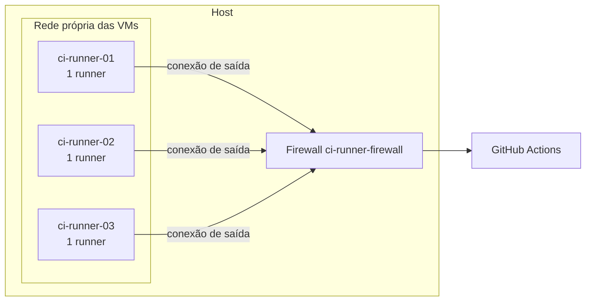

# Runners próprios

Os builds rodam em máquinas nossas, pelo próprio GitHub Actions: os workflows, a aba Actions e os checks do PR
continuam iguais. Só muda o `runs-on`. O motivo está na [ADR 0001](adr/0001-runners-proprios.md).

Este repositório é público: aqui entram a estrutura e os scripts, sem segredo nem endereço real de máquina.

## Como usar

### Em um workflow

```yaml
jobs:
  testes:
    runs-on: [self-hosted, evocode-linux]
```

### Em um workflow reutilizável desta casa

A entrada é JSON, então as aspas fazem parte do valor:

```yaml
jobs:
  ci:
    uses: evocode-ia/evocode-ci/.github/workflows/laravel-ci.yml@v1
    with:
      runs-on: '["self-hosted","evocode-linux"]'
      php-version: "8.4"
```

Sem essa entrada, o job roda no `ubuntu-latest`, com minutos pagos.

### O que muda em relação ao `ubuntu-latest`

- **Sistema:** Ubuntu 24.04 com Docker, buildx, Compose, `git`, `jq` e `build-essential`. O resto vem pelas actions
  de sempre (`setup-node`, `setup-php`, `setup-python`), que funcionam igual.
- **A máquina não é nova a cada job.** O runner é reaproveitado, e uma limpeza roda antes e depois de cada job: apaga
  workspace, `/tmp`, home, containers, volumes, redes e imagens com menos de um dia, o que inclui as construídas ali.
  Nada do que um job deixa nesses lugares chega ao próximo, mas um arquivo fora deles, como em `/etc`, pode chegar.
- **O cache do GitHub é lento aqui.** O download medido foi de 0,8 MB/s, e às vezes trava; a espera tem limite de 3
  minutos, e depois o job segue sem cache.
- **Falta algo?** Instale no próprio job ou peça para adicionar em `infra/runner-vm/user-data.yaml`.

### Onde acompanhar

| O quê | Onde |
|---|---|
| Builds e logs | Aba **Actions** do repositório e checks do PR |
| Estado dos runners | Settings → Actions → Runners, da organização |

## Devs externos

Ninguém precisa de acesso às máquinas, à VPN nem aos segredos: basta a conta no GitHub, com acesso ao repositório.
O dev abre o PR e vê o resultado nos checks, como em qualquer projeto.

**Ao dar acesso, leve em conta:** quem tem permissão de escrita em **um** repositório executa código como root em um
runner, porque basta alterar um workflow em uma branch. Um processo deixado ali pode capturar os segredos dos jobs
seguintes, inclusive de **outros repositórios** que usam os mesmos runners. Dê escrita só a quem pode ter esse poder.

A permissão base da organização também conta: se ela for "escrita", todo membro tem esse poder em todo repositório.

Não abra PR de fork nos runners sem revisar o workflow antes: quem só tem leitura também conseguiria executar código.

**Ao retirar o acesso de alguém que tinha escrita:** avalie a rotação dos segredos de todos os repositórios que usam
os runners, não só dos que a pessoa acessava.

## Como está montado



| Peça | Onde | O que faz |
|---|---|---|
| `infra/runner-vm/criar-vm.sh` | Roda no host | Instala QEMU e libvirt, cria a rede isolada e uma VM Ubuntu |
| `infra/runner-vm/firewall.sh` | Serviço `ci-runner-firewall` no host | Regras que isolam a rede das VMs |
| `infra/runner-vm/instalar-runners.sh` | Roda no host | Registra o runner na organização |
| `infra/runner-vm/runners-na-vm.sh` | Chamado pelo anterior, na VM | Instala e inicia o runner |
| `infra/runner-vm/limpa-job.sh` | Na VM, antes e depois de cada job | Remove o que o job deixou |
| `infra/runner-vm/user-data.yaml` | Primeiro boot da VM | Pacotes e usuário de administração |

Os runners não recebem conexão de fora: eles buscam trabalho no GitHub. Nenhuma porta é aberta no host.

O firewall sobe antes do `libvirtd`, que liga as VMs, e fecha tudo até descobrir a rota padrão. Os bloqueios ficam em
uma tabela `nft` própria, com prioridade anterior à do iptables: continuam valendo quando o Docker ou o Tailscale
reordenam as próprias regras ao reiniciar. Se o serviço `nftables` do host for habilitado com o `flush ruleset`
padrão, essa tabela é apagada.

### Por que uma VM por runner

Dois jobs na mesma máquina se atrapalham: disputam portas de serviço como `3306:3306`, e o `setup-php` troca o PHP
da máquina inteira, o que derrubaria um job de outro projeto com outra versão. No GitHub, cada job tem sua máquina;
aqui, o efeito é o mesmo com uma VM por runner. **Não aumente `CI_RUNNERS` para ganhar capacidade: crie outra VM.**

## Segurança

**Premissa:** quem tem escrita em um repositório executa código nos runners. A VM é tratada como máquina que pode ser
comprometida, e o estrago precisa ficar nela.

| Proteção | Como |
|---|---|
| Sem acesso ao host | VM separada, sem chave SSH, `gh` nem arquivo do host; tabela `nft` `ci_vm` |
| Sem acesso à rede local e à tailnet | A mesma tabela bloqueia redes privadas, `100.64.0.0/10`, metadata, IPv6 e a sub-rede pública do host |
| Sem acesso entre as VMs | Portas isoladas na bridge (`port isolated`) |
| Sem repositório público nos runners | Grupo de runners com `allows_public_repositories: false` |
| Administração só do host para a VM | Chave SSH; a VM não abre conexão de volta |

**O que continua aberto, e é preciso decidir conscientemente:**

- **Um job malicioso persiste na VM.** O runner tem `sudo`, como no `ubuntu-latest`, e a limpeza não alcança tudo. Um
  processo escondido lê os segredos dos jobs seguintes, de qualquer repositório, e pode copiar as credenciais do
  runner para operá-lo de fora. **Rótulo não é fronteira de segurança.** Enquanto isso valer, segredo de alto impacto,
  como o de publicação, deveria ficar em runner à parte ou no `ubuntu-latest`.
- **O disco é compartilhado.** A soma dos discos das VMs não deve se aproximar do espaço livre do host: jobs que
  escrevem até o limite podem esgotá-lo.
- **Internet.** O job alcança a internet livremente, como no `ubuntu-latest`.

**Em caso de incidente:** remova o runner em Settings → Actions → Runners, recrie a VM e faça a rotação dos segredos de
todos os repositórios que usam os runners. Só recriar a VM não basta, porque uma credencial copiada segue válida até a
remoção no GitHub.

**Depois de mudar o firewall, repita o teste de isolamento** (abaixo).

## Operação

Comandos rodados no host, por quem administra.

### Criar uma VM e registrar o runner

Serve para ampliar a capacidade. Use o próximo nome e IP livres, e o hash de `noble-server-cloudimg-amd64.img`
publicado em `https://cloud-images.ubuntu.com/noble/current/SHA256SUMS`:

```bash
sudo CI_VM_NAME=ci-runner-04 CI_VM_IP=10.77.0.13 CI_VM_IMG_SHA256=HASH CI_VM_SSH_PUBKEY="$(cat ~/.ssh/id_ed25519.pub)" infra/runner-vm/criar-vm.sh
```

Espere o primeiro boot terminar (`cloud-init status`), depois:

```bash
CI_ORG=evocode-ia CI_VM_IP=10.77.0.13 infra/runner-vm/instalar-runners.sh
```

O `gh` do host precisa do escopo `admin:org`. Em servidor sem navegador, o comando abaixo evita ficar preso em um
navegador de texto; depois de apertar Enter, autorize o código em `https://github.com/login/device`:

```bash
GH_BROWSER=true gh auth refresh -h github.com -s admin:org
```

Ao terminar de registrar, retire o escopo, para o login do host não ficar com esse poder:

```bash
GH_BROWSER=true gh auth refresh -h github.com -r admin:org
```

Cada organização tem os próprios runners: um runner registrado em uma não atende as outras. **Não confirmado:** o
GitHub só documenta runner próprio em workflow reutilizável quando ele é da mesma organização de quem chama. Em outra
organização, teste com um consumidor real antes de passar `runs-on` a este repositório.

### Migrar de servidor

Os runners não guardam nada que precise ser levado, então não há backup a restaurar:

1. No servidor novo, crie as VMs e registre os runners como acima. A partir daí, os dois servidores atendem jobs.
2. No antigo, remova cada runner em **Settings → Actions → Runners** e apague as VMs:

   ```bash
   sudo virsh destroy ci-runner-01
   ```

   ```bash
   sudo virsh undefine ci-runner-01 --remove-all-storage
   ```

3. Para remover o isolamento do servidor antigo, se ele continuar em uso. Isso remove as regras e também para o
   `libvirtd`:

   ```bash
   sudo systemctl disable --now ci-runner-firewall
   ```

### Testar o isolamento

De dentro de uma VM, cada comando abaixo precisa falhar. Use um endereço real de cada tipo: o host pela bridge e pelo
IP público, uma porta publicada pelo Docker do host, uma máquina da tailnet, um vizinho da sub-rede pública e outra VM.

```bash
timeout 4 bash -c 'exec 3<>/dev/tcp/ENDERECO/PORTA' && echo VAZOU || echo bloqueado
```

Repita depois de reiniciar o host, o Docker ou o Tailscale.

### Rotina

| Tarefa | Como |
|---|---|
| Ver as VMs | `sudo virsh list --all` |
| Entrar em uma VM | `ssh ci@IP-DA-VM` |
| Ver o runner | `systemctl status 'actions.runner.*'`, na VM |
| Limpar o disco | Automático: `/etc/cron.daily/ci-runner-limpeza` remove imagens com mais de uma semana |
| Atualizar o runner | Automático: ele se atualiza sozinho |
| Atualizar o sistema | `sudo apt upgrade`, na VM, ou recrie a VM |
| Recriar uma VM suja | Remova, como em "Migrar de servidor", e crie de novo com o mesmo nome |

### Problemas comuns

| Sintoma | Verifique |
|---|---|
| Job parado em "Waiting for a runner" | Runner offline ou ocupado. Veja Settings → Runners; crie outra VM se for fila |
| Job com `ubuntu-latest` sempre em `queued` | Com os runners hospedados desligados na organização, o job não falha: espera e não recebe máquina. Troque o `runs-on` |
| Job em `queued` em repositório público | Os runners próprios não atendem repositório público (`allows_public_repositories: false`) |
| Job falha sozinho depois de 10 minutos | A VM caiu com ele em andamento. O job não é repetido: dispare de novo. O runner volta e aceita o próximo |
| VM desligada depois de reiniciar | VM criada antes da correção do primeiro boot. Rode `virsh start` uma vez; daí em diante, reinício funciona |
| `startup_failure`, sem job criado | Cobrança da organização. O erro só aparece na página do run, na web: confira **Payment information** |
| VM sem internet | `sudo systemctl restart ci-runner-firewall`; depois, `sudo virsh net-list` |
| Porta de serviço já em uso | Existe mais de um runner na VM, ou sobrou um container: `docker ps -a` |
| Disco cheio | `docker system df` e `docker system prune -af`, na VM |

## Custo

Runner próprio não consome minutos do GitHub hoje. O GitHub chegou a anunciar uma taxa por minuto e a adiou; confira
a página de preços antes de planejar em cima disso. O orçamento de Actions da organização bloqueia o uso ao atingir
o teto, e **ao bater o teto o Actions pode parar para toda a organização**.
